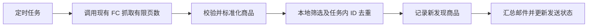

# Yahoo!フリマ 谷子监控接入调研

> 后续实现已采用独立 Yahoo!フリマ FC，在 FC 内解析商品列表；接入配置与验证方法见 [实现与部署说明](yahoo-fleamarket-setup.md)。下文保留调研时的观察与方案比较。

调研日期：2026-10-23。代码基线：`b1ffd01`。范围：Yahoo!フリマ（旧 PayPayフリマ，站点仍使用 `paypayfleamarket.yahoo.co.jp`），只调研取数与监控方案，不实现业务功能。外部结论以官方资料、少量匿名 HTTP 请求和用户授权的 Playwright 页面操作为依据；下文区分“官方说明”“本次实测”和“工程建议”。**架构前提：沿用项目现有阿里云 FC Serverless 页面抓取链路，主服务负责解析返回 HTML、去重和通知。**

## 初步结论

**技术上可接入，建议新增独立的 `YahooFleamarket` 平台。** 匿名 HTTP 搜索页已有结构化商品数据；Playwright 又验证了“新着顺＋销售中”的前两页，每页 100 条。现有定时任务、去重、邮件通知机制可复用，仓库的 `Yahoo` 则专用于日拍，不应改成フリマ。[实测搜索页](https://paypayfleamarket.yahoo.co.jp/search/%E3%81%A1%E3%81%84%E3%81%8B%E3%82%8F)、[现有 Yahoo 适配器](../src/api/site/yahoo/index.ts#L35)

**工程方案应复用 `AliCloudApi.fetchHtmlViaServerless`，由 FC 打开搜索页并返回 HTML，主服务优先解析其中的 `__NEXT_DATA__`。** 本次直接 HTTP 和本地 Playwright 仅用于查证数据结构及页面行为；实际接入仍以现有 FC 链路为准。浏览器已观察到站内 `/api/v1/search`，但它没有公开 API 的稳定性承诺。本次还观察到新着排序并非按返回的 `openTime` 严格降序，以及局部页面切换失败，因此不能用时间水位或 HTTP 200 单独判定一轮监控成功。[现有 FC 客户端](../src/api/alicloud/index.ts#L32)

目前没有找到官方公开提供的 Yahoo!フリマ 商品搜索 API。Yahoo 开发者 API 目录没有列出该服务；公开的 Shopping 商品搜索 API 明确服务于 Yahoo!ショッピング。这个结论是“未找到公开接口”，不排除受限合作接口存在。[官方 API 目录](https://developer.yahoo.co.jp/sitemap/)、[Shopping API 范围](https://developer.yahoo.co.jp/webapi/shopping/)

持续监控仍有访问规则和覆盖率问题：`robots.txt` 明确禁止爬取带排序、销售状态、价格等参数的搜索页，而裸关键词页默认是推荐排序。技术验证不等于持续采集的许可，也不能用推荐排序第一页承诺完整发现新货。[robots.txt](https://paypayfleamarket.yahoo.co.jp/robots.txt)、[推荐／新着排序说明](https://support.yahoo-net.jp/SccPaypayfleamarket/s/article/H000008470)

如果目标主要是收到新货提醒，值得先比较官方保存搜索：目前 Web 已支持保存条件，支持邮件及 App 推送，也有按每次出品即时通知的选项。若要统一谷子猎手的多站点筛选、历史记录与邮件样式，再考虑独立适配器，并先解决站点自动访问规则的适用问题。[保存搜索帮助](https://support.yahoo-net.jp/SccPaypayfleamarket/s/article/H000013029)

## 1. 平台边界与 API

| 服务 | 与本需求的关系 | 查证结果 |
| --- | --- | --- |
| Yahoo!フリマ | 本次目标，定价二手商品市场 | 当前域名仍为 `paypayfleamarket.yahoo.co.jp`，存在匿名搜索页面 |
| Yahoo!オークション | 仓库原有 Yahoo 能力对应的拍卖市场 | 部分符合条件的定价拍卖商品会同时出现在フリマ，并非两站库存完全一致 |
| Yahoo!ショッピング | 另一套商家商城服务 | 有公开商品搜索 API，但文档明确其数据范围为 Shopping，不能替代フリマ搜索 |

以上分别见 [フリマ首页](https://paypayfleamarket.yahoo.co.jp/)、[拍卖商品同步掲載条件](https://support.yahoo-net.jp/SccAuctions/s/article/H000011791)、[Shopping API](https://developer.yahoo.co.jp/webapi/shopping/)。同步掲載也意味着未来同时监控 Auctions 和フリマ时可能重复提醒，不能仅凭同为 Yahoo 就把两个站点当成同一个数据源。

公开 API 的查证范围包括官方 [API 目录](https://developer.yahoo.co.jp/sitemap/)、[开发者首页](https://developer.yahoo.co.jp/)、Shopping 产品说明和对 `developer.yahoo.co.jp` 的フリマ API 检索。没有查到可申请 Client ID 后直接调用的フリマ商品搜索文档、正式请求参数、配额或稳定性承诺。报告不把前端内部接口名称、第三方抓取服务或非官方仓库当成官方 API 证据。

## 2. 匿名搜索页与结构化数据

### 本次实测记录

以下为容器内 `python3` 标准库 `urllib.request.urlopen` 的匿名 GET，没有添加 Cookie、Authorization 或登录状态，也没有使用验证码处理或访问限制规避。

| URL | 结果 | 可支持的结论 |
| --- | --- | --- |
| `https://paypayfleamarket.yahoo.co.jp/robots.txt` | HTTP 200；659 个解码字符；`text/plain; charset=UTF-8` | 当前爬虫路径规则可直接读取 |
| `https://paypayfleamarket.yahoo.co.jp/search/%E3%81%A1%E3%81%84%E3%81%8B%E3%82%8F` | HTTP 200；460,505 个解码字符；`text/html; charset=utf-8` | 本次环境可匿名获取该关键词搜索第一页及嵌入数据 |
| `https://developer.yahoo.co.jp/sitemap/` | HTTP 200；10,836 个解码字符 | 官方公开 API 分类目录可读取 |

以上长度是本次响应经 UTF-8 解码后的字符数，并非传输字节数。搜索页同时也可被本次 web 阅读工具解析。这些是调研环境证据，尚未通过项目实际阿里云 FC 执行验证。单次成功不证明 FC 出口、其他地区、其他关键词、带筛选参数、连续轮询或未来日期都可访问；本次没有测出官方频率上限，也没有做并发／压力测试。

### 搜索结果所在位置

本次页面为 Next.js 路由 `/search/[query]`。已观察到的结构如下，属于页面快照而非公开接口契约。[对应一手页面](https://paypayfleamarket.yahoo.co.jp/search/%E3%81%A1%E3%81%84%E3%81%8B%E3%82%8F)

```text
script#__NEXT_DATA__
  props
    pageProps
      query
      currentPage
      showFilter
    initialState
      searchState
        search
          searchParams
          result
            totalResultsAvailable
            totalResultsReturned
            offset
            items[]
```

本次 `totalResultsReturned = 100`、`offset = 0`、`currentPage = 1`，`items.length = 100`。`pageProps` 不是商品列表；解析时应取 `props.initialState.searchState.search.result.items`。不能用宽泛正则在整份 HTML 中匹配商品，因为同页还包含推荐、其他模块和页面状态。

| 已观察字段 | 可承担的用途 | 需要保留的边界 |
| --- | --- | --- |
| `id`、`title`、`price` | 出品 ID、标题、当前价格 | 使用出品 ID 去重，不用标题＋价格当主键 |
| `thumbnailImageUrl`、`imageCount` | 通知缩略图 | 数据结构可改动；不要假设特定图片域名永远不变 |
| `openTime`、`endTime` | 时间信息 | 快照有 `+09:00` 时区；`openTime` 与重出品／再公开语义仍需专项验证，`endTime` 不能自动当作拍卖截标时间 |
| `itemStatus` | 商品状态 | 裸关键词样本为 `OPEN`；浏览器无销售筛选的排序请求另见 `SOLD`；销售中筛选的前两页均为 `OPEN`；不是完整枚举 |
| `sellerId`、`seller`、`condition`、`category` | 可选过滤和展示 | 第一阶段不必收集完整卖家资料 |
| `isPriceDown`、`isBulkPurchaseItem` | 附加状态线索 | 不等于已具备历史降价跟踪能力 |

同一快照中还存在 `likeCount`、`isFirstSubmit`、`isSparkleSubmit`、`log` 等内部字段；其命名不构成公开语义说明，不建议据此猜测商品来源、促销类型或发布时间。

搜索详情页 URL 采用 `/item/{id}`。官方商品详情实例可见 [商品页面](https://paypayfleamarket.yahoo.co.jp/item/z343111538)，该页公开展示商品 ID、出品日期，已售商品还可显示购买日期。搜索列表若足够支持提醒，工程上不应为每条商品再发详情请求。

### 搜索参数与分页的验证状态

裸关键词页的关键词位于路径 `/search/{URL 编码后的关键词}`，本次内嵌 `searchParams` 可观察到：

```json
{
  "results": 100,
  "query": "ちいかわ",
  "queryTarget": ":8",
  "sort": "ranking",
  "order": "DESC",
  "isExtendRange": true
}
```

这是裸关键词页的前端状态，不代表这些键都可作为公开 URL 参数使用。后续浏览器验证已确认新着排序实际使用 `openTime`，而非 `new` 或 `created_time`。分页仅验证第 1、2 页；最大页数、最大 `results` 和深分页稳定性仍未知。

官方搜索页面可见价格区间、商品状态、销售中／售罄等筛选界面；`robots.txt` 也出现了 `minPrice`、`maxPrice`、`sold`、`open`、`sort`、`order` 等路径参数，但 robots 规则本身不说明其值和组合语义。[搜索筛选界面](https://paypayfleamarket.yahoo.co.jp/search/find)、[robots.txt](https://paypayfleamarket.yahoo.co.jp/robots.txt)

### Playwright 交互与网络实测补充

2026-10-23 15:36—15:40（Asia/Shanghai），在同一个关键词页面上有限操作排序、销售状态、下一页，并直接重新打开相应 URL。没有操作登录、保存搜索、通知订阅或交易。此处是功能验证，不是持续采集或负载测试。

| 操作 | 实际页面 URL 参数 | 实际数据／结果 |
| --- | --- | --- |
| 默认搜索 | 无查询参数 | 匿名 HTTP 得到 100 条；`searchParams.sort = ranking` |
| 选择“新着順” | `withSpeller=0&sort=openTime&order=desc` | 浏览器发出 `/api/v1/search` 请求，HTTP 200，成功读出 100 条 JSON；包含 `OPEN` 和 `SOLD` |
| 勾选“販売中の商品” | 再加 `open=1` | 站内请求增加 `itemStatus=open`；页面切换一度显示“データの取得に失敗しました”；完整重新打开 URL 后，HTML 中 100 条均为 `OPEN`，页面正常显示 |
| 进入下一页 | 再加 `page=2` | 浏览器请求增加 `offset=100`；客户端切页也出现一次取数失败；完整打开第二页后，`pageProps.currentPage = 2`、`result.offset = 100`、100 条 `OPEN`，页面正常显示 |

可复核的页面：[新着＋销售中第 1 页](https://paypayfleamarket.yahoo.co.jp/search/%E3%81%A1%E3%81%84%E3%81%8B%E3%82%8F?withSpeller=0&sort=openTime&order=desc&open=1)、[第 2 页](https://paypayfleamarket.yahoo.co.jp/search/%E3%81%A1%E3%81%84%E3%81%8B%E3%82%8F?withSpeller=0&sort=openTime&order=desc&open=1&page=2)。`withSpeller=0` 是本次 UI 自动携带的参数；其可选行为没有做专项验证。

排序操作时实际观察到的站内端点如下，只作为网络证据，不是可公开使用的 API 契约：

```text
GET https://paypayfleamarket.yahoo.co.jp/api/v1/search
  ?results=100&imageShape=square&sort=openTime&order=DESC&webp=false
  &query=<URL编码后的关键词>&queryTarget=:8&isExtendRange=true
  &module=catalog:hit:21&rewriteQueryType=VECTOR
  &includeBulkPurchaseItem=true&optional=searchCondition

UI追加销售中筛选：itemStatus=open
UI进入第二页：offset=100
```

本次没有单独重放站内端点，也没有验证它脱离浏览器 Cookie／请求头后的可用性、鉴权要求、允许调用范围或限额。其他未解释参数应视为当前客户端实现细节。

另有三个直接影响实现的观察：

- **返回时间并非严格有序。** 完整打开“新着＋销售中”第一页时，100 条数据相邻 `openTime` 出现 33 处后者更新的情况。仅能确认时间字段与排序结果不严格一致，不能把原因直接归为广告、插队或再出品。扫描不能遇到一条旧时间或一个已见 ID 就提前终止。
- **ID 需要当作不透明字符串。** 第二页样本包含 `z`、`o`、`h` 开头的 ID，不能仿照某些平台写成只接受 `z\d+`。字段存在不意味着可以凭内部标志猜来源。
- **客户端切页后，`__NEXT_DATA__` 可能还是初次文档的内容。** 本次地址已变为第二页但页面报错时，原脚本仍显示 `currentPage=1`、`offset=0`；完整导航后才更新为第二页。HTTP 解析器应解析当次完整响应，浏览器验证应同时检查页面状态，不能只读旧脚本。接口记录 HTTP 200 也不足以证明切页成功；本次未查明失败来自站点、网络还是工具环境。

## 3. 搜索与“新货”的语义

官方对两种排序有明确区分：推荐排序综合相关性、卖家使用情况、价格、出品后经过时间等因素，并可能依据搜索使用倾向优化；新着排序以新出品时间为基准。普通再公开不会反映到新着排序，但再出品或手动再公开在一定条件下可能被视作新出品并排到前面。因此仅依赖“看到第一页第一条的时间”作为水位不稳妥，仍需要按 ID 去重和一定的重叠窗口。[排序说明](https://support.yahoo-net.jp/SccPaypayfleamarket/s/article/H000008470)

关键词命中也不能假设只搜索标题。官方历史功能公告说明商品描述可被搜索、App 曾增加排除关键词；但该历史公告不足以证明当前 Web 支持哪些排除参数或 AND／OR／引号语法。当前实现前应单独验收；不应套用 Yahoo 网页搜索或 Auctions 的运算符规则。[官方搜索功能改善公告](https://paypayfleamarket.yahoo.co.jp/notice/function/80/)

搜索结果也不是全站完整库存的保证。官方有商品过滤机制，关闭后仍无法查看已删除商品；另有合并购买商品、预留／部分特定分类不出现在关键词结果的说明。因此“搜索里消失”不能直接判为“已售”，也不能承诺覆盖所有商品。[商品过滤帮助](https://support.yahoo-net.jp/SccPaypayfleamarket/s/article/H000008434)、[搜索不显示的情况](https://support.yahoo-net.jp/SccPaypayfleamarket/s/article/H000012392)

## 4. 访问规则、地区与运行稳定性

### robots.txt 的实际限制

本次直接读取的 `robots.txt` 对 `User-agent: *` 包含以下规则片段：

```text
Disallow: /search/*?*sort=
Disallow: /search/*?*order=
Disallow: /search/*?*specs=
Disallow: /search/*?*conditions=
Disallow: /search/*?*sold=
Disallow: /search/*?*open=
Disallow: /search/*?*minPrice=
Disallow: /search/*?*maxPrice=
Disallow: /search/*?*showFilter=
```

此外还限制 `/my/`、编辑／议价／提问、优惠券等路径，以及带对应筛选参数的 `/product/` 路径。裸关键词 `/search/{keyword}` 没有被这一份 robots 明确禁止，但不能由此推出页面数据可任意再利用。robots 是站点的爬虫指示，不等于法律授权或法律结论。[原始 robots 文件](https://paypayfleamarket.yahoo.co.jp/robots.txt)

对监控的直接影响：最有价值的“最新排序＋仅售卖中＋价格条件”涉及被禁止的参数路径。匿名 HTTP 子任务没有请求这些组合；后续按用户补充进行了少量正常页面交互和完整导航，验证记录见上文。浏览器能打开、站内 API 能响应都不改变这些爬虫指示；不应把更换请求入口当成持续采集的授权依据。

### 条款与登录

フリマ指南同时适用 LINE Yahoo 共同条款。フリマ指南第 7／8 条对超出商品交易所需范围收集、使用其他用户资料和投稿内容作出限制，涉及的内容包括数据、文字与图片；共同条款第 14 条限制超出提供目的再利用服务数据，第 15 条涉及不正 BOT 操作、不当逆向及非法收集第三方资料。这里需要判断拟议监控用途的适用性，不能从页面可读直接推出持续自动采集被允许，也不宜把上述条款概括为“所有自动访问一律违法”。[フリマ指南](https://paypayfleamarket.yahoo.co.jp/guide/guideline/)、[共同条款](https://www.lycorp.co.jp/ja/company/terms/)

官方帮助明确：商品浏览等一部分功能无需登录，保存搜索需要 Yahoo! JAPAN ID。买卖涉及手机号、SMS、地址等额外准备，但本次商品监控研究不需要购买登录权限。[注册与匿名浏览帮助](https://support.yahoo-net.jp/SccPaypayfleamarket/s/article/H000011705)、[保存搜索帮助](https://support.yahoo-net.jp/SccPaypayfleamarket/s/article/H000013029)

### 地区与错误处理

官方明确 Yahoo! JAPAN 大部分服务不向 EEA 与英国提供，例外列表未包含フリマ。这不能扩展成“只有日本 IP 可以访问”，也没有足够证据断言中国大陆所有出口均能访问。本次容器的一次成功不替代实际部署网络验证。[不可使用地区帮助](https://support.yahoo-net.jp/PccOverseasuse/s/article/H000013813)

没有查到官方公开的フリマ抓取 QPS、每日请求额、Cookie 生命周期或反爬阈值。Shopping 文档中提到的调用限制只适用于其 API，不能挪用作フリマ的安全配额。未来若获准运行，应把超时、403、429、登录页／验证码页、数据结构变化分别视作任务错误或需要退避的状态；不能在解析失败时把整轮记成“0 件商品”，更不能靠高频重试维持请求。[Shopping 范围及其限制](https://developer.yahoo.co.jp/webapi/shopping/)

## 5. 原生通知是实际可用的替代方案

截至本次调研，官方帮助与近期公告已经支持以下能力：

| 能力 | 当前官方说明 |
| --- | --- |
| 保存搜索 | 登录后最多保存 20 个条件，可包含关键词、分类、品牌与规格 |
| 通知渠道 | App 推送和邮件；同时开启时共用同一频率设置 |
| 通知频率 | 每次新出品“立即通知”，或每天 1／2 次汇总 |
| 即时条件限制 | 过去 24 小时新出品达到 500 件及以上的搜索条件，无法选择即时通知 |
| 总通知上限 | 每个 Yahoo! JAPAN ID 的推送与邮件分别最多每天 1,000 通；推送还与部分其他提醒共享额度 |
| Web 使用 | 2026-03-12 公告已支持 PC／手机浏览器保存搜索条件 |

以上来自 [当前保存搜索帮助](https://support.yahoo-net.jp/SccPaypayfleamarket/s/article/H000013029)。通知功能发展时间可由三个官方公告核对：[2025-06-18 增加即时通知](https://paypayfleamarket.yahoo.co.jp/notice/function/post_1047/)、[2026-02-24 增加邮件通知](https://paypayfleamarket.yahoo.co.jp/notice/function/post_1193/)、[2026-03-12 Web 保存条件](https://paypayfleamarket.yahoo.co.jp/notice/function/post_1202/)。不要继续沿用“只能 App 保存、只能推送、一天两次”的旧信息。

这可以直接满足少量精准关键词的提醒需求，但不自动提供谷子猎手中的跨站统一筛选、历史查询、统一去重和自定义通知样式。把官方邮件再导入谷子猎手是另一种候选设计，仍需用户授权邮箱访问并验证真实邮件结构；本次未读取用户邮箱，也未验证邮件是否包含每件商品的完整结构。

“均一フリマ”的条件保存另有规则且没有新货通知，不能与普通关键词搜索的通知能力混同。[相同帮助中的均一フリマ说明](https://support.yahoo-net.jp/SccPaypayfleamarket/s/article/H000013029)

## 6. 方案选择与未决问题

| 路径 | 可取之处 | 当前决策条件 |
| --- | --- | --- |
| 用户直接用官方保存搜索 | 已具备即时／邮件通知；无需维护页面解析 | 适合不超过 20 个条件且接受官方筛选与通知样式的需求 |
| 独立フリマ适配器，经现有 FC 获取 HTML 并解析嵌入数据 | 调研环境已证明页面含监控最小字段；符合现有各平台的 FC 抓取方式 | 需在实际 FC 验证出口、页面断言及返回 HTML；默认推荐页不保证新货覆盖率；需防结构变动 |
| 站内未公开 JSON API | 已观察 `/api/v1/search` 返回结构化列表，流量可能比整页小 | 独立匿名调用、鉴权及限额未验证；有维护成本，不宜当作官方 API |
| 本地 Playwright 调研工具 | 已用于验证排序、销售中、分页与实际请求 | 调研证据需在现有 FC 抓取环境复核；FC 继续承担生产页面抓取，本地工具用于验证与排查 |

后续实现前最有价值的验证项目是：

1. 确认可接受的正式自动访问方式，以及排序／筛选路径的站点规则。
2. 通过实际阿里云 FC 验证页面访问、加载断言、返回 HTML、错误页识别和合理轮询策略；不宣称本次研究给出了可长期运行的频率。
3. 继续核验深分页、完整状态枚举、`openTime` 对重出品／手动再公开的行为；前两页和 `OPEN`／`SOLD` 已有实测。
4. 明确是否将 Auctions 同步商品视作同一条通知，以及新出品、首次发现、再公开、降价各自的产品语义。
5. 若选择官方邮件路线，另做用户授权后的真实邮件字段与去重验证。

## 7. 谷子猎手的具体接入位置

以下基于仓库 `b1ffd01` 的代码阅读，不是已完成的业务变更。当前项目是 Midway／TypeScript，使用 TypeORM、MySQL、Cron 和邮件通知；代码依赖见 [package.json](../package.json)。

### 现有能力与建议改动

| 层次 | 当前代码证据 | 新平台建议 |
| --- | --- | --- |
| 平台标识与搜索类型 | [CONST.HUNTERTYPE](../src/const.ts#L3)、[搜索条件联合类型](../src/api/site/types.ts#L15)、[Hunter 类型](../src/types.ts#L14) | 新增 `YahooFleamarket` 与独立搜索类型，保留现有 `Yahoo` 日拍含义 |
| 数据获取 | [YahooAuctionApi](../src/api/site/yahoo/index.ts#L111) 经 FC 获取 `auctions.yahoo.co.jp` HTML，再解析竞拍字段 | 新增 `src/api/site/yahooFleamarket/`；复用相同 FC 客户端，将搜索 URL 构建、HTML 解析和业务标准化隔离 |
| FC 抓取调用 | [AliCloudApi.fetchHtmlViaServerless](../src/api/alicloud/index.ts#L32) 接收目标 URL、加载断言、Cookie、等待／重试参数和可选脚本，返回 HTML 等状态 | 由 FC 完成各搜索页导航与抓取，主服务校验 `success/content` 并解析 JSON；沿用现有签名鉴权和配置。客户端超时为 120 秒，页数、并发及重试需计入任务总时长 |
| 定时执行 | [HunterBase](../src/service/hunterArsenal/base.ts#L25) 管理 Cron、休眠时段与任务持久化 | 新增 `YahooFleamarketHunterService extends HunterBase`，复用调度方式，加任务执行互斥及站点级限流 |
| 搜索去重与通知 | [现有 Yahoo goHunt](../src/service/hunterArsenal/yahoo.ts#L112) 查询已见 ID 后发邮件、存记录 | 使用フリマ ID 去重；不沿用 `auctionId/currentBidCount/buyNowPrice` 的业务模型 |
| 数据实体 | [YahooHunter](../src/model/yahooHunter.ts#L7)、[YahooAuctionRecord](../src/model/yahooAuctionRecord.ts#L5)、[User 关联](../src/model/user.ts#L39) | 新增平台任务实体与记录实体，增加 User 关联；记录唯一约束按任务＋商品 ID 设计 |
| 注册、列表、更新、删除 | [GoodsController](../src/controller/goods.ts#L33)、[HunterRouteService](../src/service/hunterRouteService.ts#L69)、[GoodsService.deleteTask](../src/service/goods.ts#L46)、[Hunter 导出](../src/service/hunterArsenal/index.ts) | 逐个补全分发，尤其任务删除时的实体选择，不能只加注册分支 |
| 通知模板 | [template.ts](../src/template.ts)、[Yahoo 邮件模板](../view/yahoo/goodsList.ejs) | 新模板指向 `https://paypayfleamarket.yahoo.co.jp/item/{id}`；首版不带尚未支持的单品订阅链接 |
| 本地验证 | [现有 Mock](../src/mock/api.ts)、[Hunter 测试](../test/service/hunter.test.ts) | 增加脱敏 HTML fixture 与真实行为断言；现有相关测试主要是 smoke，不能替代新平台的去重验证 |

当前 [view/index.ejs](../view/index.ejs) 只有临时登录表单，没有完整任务管理 UI。首版可沿用现有 `/goods/registerGoodsWatcher` 等接口，增加完整任务管理页面应另计范围。

### 沿用 FC 的调用边界

当前 [Mercari](../src/api/site/mercari/index.ts#L29)、[Yahoo 日拍](../src/api/site/yahoo/index.ts#L111)、[Surugaya](../src/api/site/surugaya/index.ts)、[Mandarake](../src/api/site/mandarake/index.ts) 的列表抓取均调用 FC 客户端；Yahoo!フリマ 应遵循同一条链路：

```text
YahooFleamarketHunter
  → YahooFleamarketApi 构建带排序／在售／页码的目标 URL
  → AliCloudApi.fetchHtmlViaServerless(targetUrl, ...)
  → 阿里云 FC 加载页面并返回 content HTML
  → 主服务校验当前页数据，解析 __NEXT_DATA__，标准化商品
  → 任务去重、持久化、邮件通知
```

实施时需要通过真实 FC 调用确认以下契约：

- **每页对应完整导航。** 第一页和第二页分别提交完整 `targetUrl`，解析各自返回的 HTML。结合本次客户端切页遗留旧脚本的观察，校验 `pageProps.currentPage`、关键词、排序条件及 `result.offset` 是否对应请求，防止读到旧页快照。
- **加载断言需要验证语义。** 客户端将 `pageLoadedAssertion` 作为 `page_loaded_assertion` 原样发送；仓库未包含 FC 内部实现，不能断言它采用 CSS 选择器、文本匹配或其他规则。可先评估 `__NEXT_DATA__` 作为候选断言，再在主服务验证 JSON 及当前页；仅脚本存在不能证明抓取成功。
- **沿用现有请求契约。** 先验证无账号 Cookie 是否足够；Cookie、`evaluate_script`、等待时间及 `max_retries` 仅在实际需要时配置。校验 `success`、`content`、`error` 和返回页状态；不能把 FC HTTP 200 当成目标站取数成功。
- **按 FC 成本和耗时设计调度。** 每轮扫描页数、并发、单页重试与 120 秒客户端超时共同决定执行时间；相同条件缓存、同任务互斥和失败退避都应围绕 FC 调用设计。本次没有实际测量 Yahoo!フリマ 的 FC 耗时、费用或成功率。

现有客户端契约可以承载这类页面抓取，因此先验证复用是否足够；是否需要修改 FC 本体，应根据实际返回内容和加载断言结果决定。当前只阅读了本仓库 FC 客户端，未审阅或修改 FC 服务端实现。

### 建议首版行为

目标先定义为：**按关键词周期搜索，把本任务此前未发现、目前销售中的商品汇总发邮件。** “首次发现”不等于“刚刚发布”；后续再考虑单品降价／售罄跟踪。



建议的搜索条件如下，是拟议的内部类型，不是已实现字段或 Yahoo 官方参数：

```ts
type YahooFleamarketSearchCondition = {
  keyword: string;
  epoch?: number;           // 有上限的扫描页数，兼容项目现有命名
  onSaleOnly?: boolean;    // 建议默认 true
  minPrice?: number;       // JPY 整数，可先本地筛选
  maxPrice?: number;
  excludeKeywords?: string[]; // 先在已获取的标题上本地排除
};
```

标准化商品最少保存 `id/title/price/thumbnailImageUrl/itemUrl/itemStatus`，可选保存 `openTime` 和 `firstSeenAt/lastSeenAt/notifiedAt`。不采集不需要的卖家资料。`endTime`、竞拍次数和即决价不作为本平台通知字段。

执行策略建议：

1. 第一轮建立已见基线，默认不把整页存量当作新货群发；如需要初始结果，可提供单独选项。这与现有 Yahoo 首轮会通知全部未见结果的行为不同，需要在新增平台说明中明确。
2. 每轮扫描配置范围内的全部页，跨页先按 ID 去重，再与本任务已见记录比较；不以单条旧时间或已见 ID 提前终止。热关键词的新增量若超过扫描窗口，仍可能漏报，扩大页数也不是完整性保证。
3. 本地价格／排除词过滤只作用于抓到的窗口，不能增加上游召回率；排除范围先限定标题，不声称覆盖商品描述。关键词扩展匹配、无结果时的推荐补充要独立识别，不能混作严格命中。
4. 先用保守、可配置的轮询间隔，结合部署环境的成功率、返回量与覆盖率调整；相同规范化条件可共享短期抓取缓存，去重和通知记录仍按任务分别保存。本次没有测得任何官方允许的频率。
5. `OPEN` 为可售候选，`SOLD` 为已售；未知状态保留原值并跳过告警，不默认当成销售中。商品从列表消失时不自动判为已售。已见 ID 再出现默认不重复发送；同内容被新 ID 重新出品则按新 ID 处理。
6. 无结果须有可验证的空结果结构；缺失脚本、结构不符、错误页和访问受限都记为失败，不清空已见基线，不产生空商品通知。403／429 等停止立即重试并退避，记录失败原因和最后成功时间。
7. 站内搜索结果中有不同 ID 前缀，且官方确认部分日拍商品同步到フリマ。首版可先各平台独立去重；跨平台共用 ID／URL 的对应关系尚未验证，不做标题相似度合并，避免误吞不同商品。

### 实现时需要同时处理的现有接点问题

这些是与新平台接入直接相关的代码观察；本次只记录，没有修改：

- **任务更新分发缺少 `type`。** [控制器](../src/controller/goods.ts#L140) 调用 `transferHunter` 时没有传入平台类型，[路由服务](../src/service/hunterRouteService.ts#L86) 却根据 `info.type` 判断分支。新增平台若照抄，更新请求会无法路由。实现 CRUD 时应一并补传类型并验证。
- **更新条件与重置基线需要明确时序。** [HunterBase.transfer](../src/service/hunterArsenal/base.ts#L197) 没有 await 数据库事务；[Yahoo 子类](../src/service/hunterArsenal/yahoo.ts#L172) 又在调用它之后读取所谓旧条件。新平台应在更新前读旧值并等待事务结束，根据完整规范化搜索条件决定是否重建基线，而非只比较关键词。
- **Cron 的激活状态不等于本轮没有运行。** [spawnCronJob](../src/service/hunterArsenal/base.ts#L113) 没有为 `goHunt` 加执行锁；慢请求可能与下次调度重叠。新平台至少要有同任务互斥；多实例部署再考虑分布式锁。
- **现有去重不是严格一次投递。** [当前流程](../src/service/hunterArsenal/yahoo.ts#L141) 是先发邮件再插入记录，邮件成功而数据库失败时，下轮可能重发。新增平台宜保存待发送记录及发送状态，再发送并确认；即使这样，SMTP 成功与状态提交之间仍有重试边界。若需要更强投递保证，再单独设计 outbox 与幂等策略。

## 8. 建议的实施顺序与验收

以下是实施分解，不是已经完成的任务或工时承诺：

1. **FC 数据适配验证。** 经现有 `fetchHtmlViaServerless` 在实际 FC 环境验证首页与分页 HTML、加载断言、成功／失败状态和抓取耗时；实现纯解析函数与 URL 构建。固定样本覆盖第一页、第二页、无结果、错误页、缺字段、未知状态。确认上游筛选／分页语义，再确定是否需要调整 FC 内部实现。
2. **关键词监控闭环。** 新平台类型、任务／商品实体、路由分发、ID 去重、Cron 互斥、汇总邮件、创建／列表／更新／删除；同步修复上述影响路由与基线更新的接点。接口可沿用现有任务 API。
3. **短期观察运行。** 用少量明确关键词检查页面／结构变化、失败退避、重复邮件和窗口覆盖；再决定是否需要更深分页、缓存共享或额外筛选。搜索总数返回值是否封顶也待验证。
4. **可选扩展。** 单品降价／售罄监控、跨 Auctions 去重、官方提醒邮件导入，分别验证；不在首版邮件里预先露出不可用入口。

核心验收案例：同一页连续执行不重复提醒；跨页重复 ID 只产生一条；首轮与条件变更按基线策略执行；排序中夹旧商品仍继续扫描；`SOLD`／未知状态不冒充可售；取数失败不污染基线；邮件失败可重试；慢请求不并行执行同一任务；用户只能更新／删除自己的任务。保留既有 Yahoo 日拍注册及通知的回归验证。

**推荐决策：新增独立平台，复用现有阿里云 FC 获取搜索页 HTML，主服务解析 `__NEXT_DATA__`，先打通关键词新货提醒。** 本地 Playwright 用于验证与排查；站内 JSON API 作为结构证据。实际 FC 链路、持续自动访问规则和运行可靠性仍需验证。当前交付是调研文档，未修改业务代码、数据库、FC 或部署配置。
